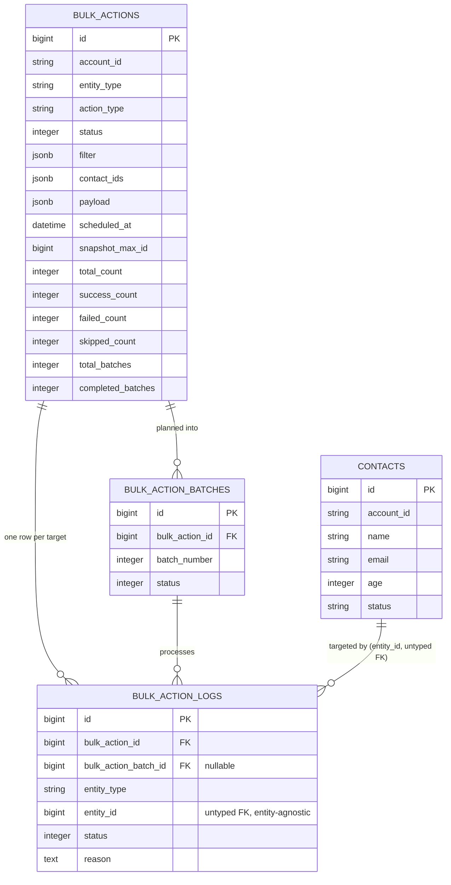

# Architecture

This document explains the design decisions behind the Bulk Action Platform, not just what
the code does. For setup instructions see the main [README](../README.md).

## 1. Goals, restated

The assignment's core tension is between two requirements that pull in opposite directions:

- **Scale**: architecture must reason about up to a million entities per bulk action.
- **Extensibility**: adding a new action (delete, email, export, assign, archive) must not
  require touching existing code.

Everything below is either in service of one of those two goals, or of the supporting
requirements (logging, stats, rate limiting, de-duplication, scheduling) layered on top without
compromising either.

## 2. Database schema



(If the diagram above doesn't render in your viewer: `bulk_actions` has many `bulk_action_batches`
and many `bulk_action_logs`; `bulk_action_batches` has many `bulk_action_logs`; `bulk_action_logs`
references a target row by `(entity_type, entity_id)` rather than a typed foreign key — see §3.)

**Why `entity_id` is untyped.** `bulk_action_logs.entity_id` is a bare `bigint`, not a foreign key
to `contacts`. A real foreign key would need to point somewhere different for every entity type
(`contacts`, `companies`, `leads`, ...), which Postgres foreign keys can't express polymorphically
without either a separate join table per entity or Rails' polymorphic-association convention (a
paired `entity_type` string, which is exactly what's used here — same idea, no extra gem). This is
the crux of "entity-agnostic": nothing about the log/batch/action tables assumes `Contact` exists.

**Why `bulk_action_batches` exists at all** (it wasn't in the first draft of this design). Without
it, "has this batch already finished?" has no place to live, and detecting "the whole bulk action
just completed" becomes a race — see §5.

**Why `payload` is a single generic jsonb column, not typed update columns.** A future Bulk Email
action needs a subject/body/template id; Bulk Assign needs an owner id; Bulk Delete needs nothing.
A generic payload interpreted by whichever strategy class is registered for `action_type` is what
actually delivers on the extensibility requirement — typed columns would mean a migration every
time a new action ships, which is precisely what this is trying to avoid.

**Why no `accounts` table.** `account_id` is an opaque string column, and the rate limit is a
single global `ENV`-configured constant rather than a per-account override. Building out a real
accounts/auth system wasn't asked for and would be pure surface area for this assignment's scope —
flagged here as the obvious next table to add (`rate_limit_per_minute` column) if per-account
overrides were ever needed.

**Indexes**: `contacts(account_id, status)` and `contacts(account_id, email)` for filtered
targeting; `bulk_actions(account_id, status)` and `(scheduled_at)` for the list endpoint and the
scheduler; `bulk_action_batches(bulk_action_id, batch_number)` **unique** (idempotency, see §5) and
`(bulk_action_id, status)`; `bulk_action_logs(bulk_action_id, entity_id)` **unique** (idempotency)
and `(bulk_action_id, status)` (fast stats/log filtering — the stats endpoint never scans this
table at all, see §8).

## 3. Extensibility: Strategy + Registry

```
app/services/bulk_actions/
  base.rb               # the interface every action implements
  registry.rb            # entity_type + action_type -> strategy class
  contact_bulk_update.rb # ships with the assignment
  contact_bulk_archive.rb # a SECOND action, added to prove the pattern
```

`BulkActions::Base` defines the contract: `.allowed_payload_keys` (a whitelist, see §9) and
`#call(entity)`. `BulkActions::Registry::MAPPING` is a plain hash: `["Contact", "bulk_update"] =>
"BulkActions::ContactBulkUpdate"`. Adding **Bulk Delete** tomorrow is:

```ruby
# app/services/bulk_actions/contact_bulk_delete.rb
module BulkActions
  class ContactBulkDelete < Base
    def call(contact) = contact.destroy!
  end
end
```
```ruby
# one line in registry.rb
%w[Contact bulk_delete] => "BulkActions::ContactBulkDelete",
```

Nothing in `BulkActionsController`, `BulkActionEnqueueJob`, `BulkActionBatchJob`, or any model
changes. `ContactBulkArchive` exists in this repo specifically to demonstrate that — one class,
one registry line, done. This is a deliberately small, boring implementation of the Strategy
pattern (a hash lookup) rather than a heavier Factory/plugin-registration framework, because a
hash lookup is all four required properties (open for extension, closed for modification, no
runtime magic, trivially testable) actually need.

## 4. Targeting a set of entities

A request selects targets one of two ways:

- **`filter`** — a whitelisted jsonb query description (`ContactsFilterQuery::ALLOWED_FILTER_KEYS`
  = `status`, `age`, `name`, `email`), meant for the "up to a million" scale case.
- **`contact_ids`** — an explicit id array, the "UI: select these N checked rows" convenience path.
  Capped at `BULK_ACTION_MAX_CONTACT_IDS` (default 10,000, `app/models/bulk_action.rb`) — otherwise
  a client could post a million-element array over HTTP and defeat the entire point of `filter`
  existing.

`ContactsFilterQuery` (`app/services/contacts_filter_query.rb`) is the single place that turns
either into an `ActiveRecord::Relation`, and it **always** starts from
`Contact.where(account_id: bulk_action.account_id)` before merging anything client-supplied — an
`account_id` key inside `filter` is rejected as an unknown key (not silently dropped, not trusted),
so a client can never widen or escape tenant scoping through the filter hash. This is checked
twice: synchronously in `BulkAction`'s own validation (immediate 422 at creation time) and again
structurally by `ContactsFilterQuery` itself when the background job actually runs the query — the
model validation calls the exact same `ContactsFilterQuery.validate_keys!` the query object uses,
so there's one whitelist, not two copies that could drift.

## 5. The job pipeline: two phases, not a streaming loop

`app/jobs/bulk_action_enqueue_job.rb` and `app/jobs/bulk_action_batch_job.rb`. Both are plain
`Sidekiq::Job` classes (not `ActiveJob`) — deliberately, so scheduling can use Sidekiq's own
`perform_at`/`perform_in` directly (see §7) rather than going through ActiveJob's thinner
scheduling API.

**Phase 1 — Plan** (`BulkActionEnqueueJob#plan!`, wrapped in one DB transaction):

1. Resolve the target `Contact` relation, capture `snapshot_max_id = relation.maximum(:id)` —
   freezing the target set at submission time so a bulk action can't silently grow if rows are
   inserted after it was submitted (also just correct CRM semantics: "these 50,000 leads" should
   mean the 50,000 that existed when you clicked the button).
2. Run **one** SQL statement:
   ```sql
   INSERT INTO bulk_action_logs (bulk_action_id, entity_type, entity_id, status, reason, created_at)
   SELECT :bulk_action_id, :entity_type, id,
          CASE WHEN rn = 1 THEN 0 ELSE 3 END,          -- 0=pending, 3=skipped
          CASE WHEN rn > 1 THEN 'duplicate email' END,
          :now
   FROM (
     SELECT id, ROW_NUMBER() OVER (PARTITION BY LOWER(TRIM(email)) ORDER BY id) AS rn
     FROM (<the scoped, snapshot-bounded contact relation>) AS targeted_contacts
   ) AS ranked
   ```
   This is the entire de-duplication feature. It computes, in one set-based statement with no
   Ruby-side iteration: which rows are duplicates by normalized (lower-cased, trimmed) email
   **globally across the whole target set**, deterministically (lowest id per email always wins,
   so re-running the same input gives the same answer — a Redis-`SADD`-based "first one seen by
   whichever worker gets there first" approach would be nondeterministic under concurrent
   batches), and writes every target's log row in the same statement. Duplicates never get
   dispatched to a worker at all — there's no batch job that "discovers" a row is a duplicate.
   (`scoped.to_sql`, embedded in the outer SQL string, is safe to inline because ActiveRecord/the
   pg adapter already quotes every value that relation's `WHERE` clause contains — this is
   composing two already-parameterized SQL fragments, not string-interpolating raw client input.)
3. Group the resulting `pending` log rows into batches via `find_in_batches` (default 1000,
   `ENV["BULK_ACTION_BATCH_SIZE"]`) — only `batch_size` ids in memory at any moment, regardless of
   whether the target set is 2,000 or 2,000,000. One `bulk_action_batches` row per batch.
4. Only **after** every batch row exists does it write `total_count`/`skipped_count`/
   `total_batches`/`status=processing` — once, atomically.

**Why step 4 waits until every batch exists, instead of streaming batches out as they're
created**: if `total_batches` were incremented incrementally while batch jobs were already running
against earlier batches, an early-finishing batch could observe `completed_batches ==
total_batches` (and wrongly finalize the parent) before the last batch had even been created. This
was caught in an adversarial design-review pass before writing any code — see §12. Waiting costs
nothing but a few seconds of extra planning latency (grouping rows into batches is cheap; no
per-entity work happens yet) and it fully removes the race by construction: nothing can be
"complete" against a number that hasn't been fixed yet.

**Phase 2 — Dispatch**: loop over the batch rows just created (or, on a redelivery after phase 1
already committed, over whatever's still `pending`/`processing`) and `BulkActionBatchJob
.perform_async(batch.id)` for each. This split is also what makes the whole job safely re-entrant:
`perform` checks `bulk_action.queued? || bulk_action.scheduled?` before planning at all — if a
Sidekiq redelivery lands after phase 1 already committed (status is now `processing`), planning is
skipped and only dispatch re-runs, which is safe because re-dispatching an already-claimed or
already-completed batch is a no-op (§6).

**`BulkActionBatchJob`** processes one batch:

1. **Claim**: `UPDATE bulk_action_batches SET status='processing' WHERE id=? AND status IN
   ('pending','processing') RETURNING id` (`BulkActionBatch#claim!`). Returns false (no-op) if
   another attempt already has it, or it's done.
2. **Rate limit check** (§7) — may bounce the whole batch back to the queue without touching any
   rows.
3. **Per row**: wrap the strategy's mutation in its own transaction/rescue.
   - Business/validation errors (`ActiveRecord::RecordInvalid`, `BulkActions::Base::BusinessError`)
     are caught, the log row flips to `failed` with the message, and the loop **continues** — one
     bad row must never take down the batch.
   - Anything else (a dropped DB connection, a Redis timeout) is **not** rescued — it propagates,
     aborts the job, and Sidekiq's own retry+backoff reruns the batch. Safe, because every row
     transition is guarded by `WHERE status = 'pending'` (`BulkActionLog#mark_success!`/
     `#mark_failed!`), so a retry only ever touches rows the previous attempt didn't finish.
4. Counters (`success_count`/`failed_count`) are incremented by the **actual count this invocation
   flipped** (via `update_counters`), never by the batch's nominal size — a partial retry can't
   double-add counts for rows an earlier attempt already tallied.
5. **Finalize**: `UPDATE bulk_action_batches SET status='completed' WHERE id=? AND status !=
   'completed' RETURNING id` (`BulkActionBatch#finalize!`) — true only for the call that actually
   flips it. Only then does it atomically increment `bulk_actions.completed_batches` and compare
   to `total_batches`; if equal, it finalizes the parent, itself guarded by `WHERE status !=
   'completed'` so two batches finishing in the same instant can't both "complete" the parent.

## 6. Why this is safe under Sidekiq's at-least-once delivery

Every mutating step above is phrased as a conditional `UPDATE ... WHERE <not-already-done>
RETURNING`, and the boolean it returns (did *this* call actually change the row?) is what downstream
counting/finalization logic keys off. Nothing here assumes a job runs exactly once. This is what
"idempotent by construction" means in practice, applied at three levels: per-row
(`bulk_action_logs`), per-batch (`bulk_action_batches`), and per-bulk-action (`completed_batches`
vs. `total_batches`).

## 7. Rate limiting

`app/services/rate_limiter.rb`, checked once per **batch** (not per row) in
`BulkActionBatchJob` — batches are the unit being throttled, not individual events. Default 10k
processed rows/account/minute, `BULK_ACTION_RATE_LIMIT_PER_MINUTE`.

A hard fixed window (`INCR` a `minute-bucket` key) allows up to ~2x the limit across a minute
boundary (a burst right before :00 plus a burst right after). Instead this uses a **sliding-window
approximation**: two keys (current minute, previous minute), estimate = `previous *
(seconds-remaining-in-current-window / 60) + current`. One extra `GET` versus a fixed window, no
memory cost of a true sliding log (which would mean tracking every individual event timestamp per
account — unnecessary at 10k/min). Each key gets a 120s `EXPIRE` on write so nothing leaks in
Redis. A bounced batch re-enqueues via `perform_in(seconds_to_next_window + rand(0..5))` — the
jitter avoids every throttled account's retries landing on the exact same window boundary
(thundering herd).

**Trade-off, stated plainly**: throttling whole batches means actual throughput can undershoot the
cap by up to `batch_size - 1` in a given window (a batch that would tip 999 over the limit is
bounced entirely, not split to fill the remaining 999). At the default 1000/10,000 that's a ~10%
worst case. Splitting a batch to fill the remaining quota exactly was judged not worth the added
complexity for what this assignment is testing.

**Operational constraint this implies**: `BULK_ACTION_RATE_LIMIT_PER_MINUTE` must stay ≥
`BULK_ACTION_BATCH_SIZE`. A batch is bounced as a whole, never split — so a batch that on its own
already exceeds the limit can never be admitted, in any window, and will retry forever. Confirmed
live during development: with the limit set below a batch's size, `BulkActionBatchJob` re-enqueued
itself every window indefinitely (never raising, so Sidekiq's own retry-exhaustion/dead-set never
kicked in either) until the bulk action was cancelled through the API. With the limit at its
sensible default (10,000, well above the 1,000 default batch size) this can't happen; it's only a
risk if the two are deliberately misconfigured relative to each other.

## 8. Stats and logs — read paths

`GET /bulk-actions/:id/stats` reads five integer columns off one row — O(1), safe to poll as
often as a UI wants, never touches `bulk_action_logs`. `processed_count` (success + failed +
skipped) and `percentage_complete` are computed in Ruby from those columns rather than stored
redundantly, so there's exactly one place (`success_count`/`failed_count`/`skipped_count`) that
can ever drift from reality.

`GET /bulk-actions/:id/logs` uses **keyset pagination** (`WHERE id > :after ORDER BY id LIMIT n`),
not `OFFSET`, which is the only pagination style that stays fast on the millionth row of a log
table this large — `OFFSET 999000` still has to walk 999,000 rows in Postgres.

## 9. Security notes

- **Multi-tenancy**: covered in §4 — `filter` can never override `account_id` scoping, checked at
  both request time (model validation) and job time (query builder), same whitelist function.
- **Mass-assignment**: `payload` is a free-form jsonb column, but `BulkAction`'s validation checks
  every key against `strategy_class.allowed_payload_keys` — for `ContactBulkUpdate` that's exactly
  `name`/`email`/`age`/`status`, so a payload of `{"account_id": "someone-elses"}` is rejected at
  creation, not merely ignored at update time.
- **SQL injection**: the one place this system hand-writes SQL (§5, step 2) never interpolates
  client-supplied strings directly — `entity_type` comes from the server-validated, registry-keyed
  `bulk_action.entity_type`, and the filter conditions are built exclusively through
  ActiveRecord's own parameter binding before being rendered to SQL text.

## 10. Horizontal scaling

- **Stateless web tier**: any number of Puma processes/pods behind a load balancer; all
  coordination lives in Postgres (counters, claim/finalize guards) and Redis (rate limiter), never
  in-process memory.
- **Dedicated Sidekiq queues** (`config/sidekiq.yml`): `bulk_action_batch` (weight 3) and
  `bulk_action_enqueue` (weight 2) separate from `default`, so a flood of bulk-action work can't
  starve unrelated background jobs, and vice versa. In production you'd run planning and batch
  workers as separate Sidekiq processes/deployments with independent concurrency and independent
  autoscaling (many batch workers, few planning workers — planning is one job per bulk action;
  batch processing is where the real parallelism lives).
- **DB connection pool sizing**: `config/database.yml`'s `max_connections` must be ≥ Sidekiq
  concurrency per process, called out explicitly in a comment there — a very common way this kind
  of system silently falls over under load (`ActiveRecord::ConnectionTimeoutError`) that a
  reviewer will specifically check for.
- **Adding more Sidekiq processes or Postgres read replicas requires zero application code
  changes** — every coordination primitive above is already safe for N concurrent workers, not
  just designed for one.

## 11. Failure recovery, end to end

| Failure | What happens |
|---|---|
| One entity fails validation mid-batch | Logged `failed` with the reason, batch continues (§5.3) |
| Entity deleted between planning and processing | Logged `failed`, `"entity no longer exists"` |
| DB/Redis blip during a batch | Job aborts, Sidekiq retries the whole batch; already-finished rows are skipped via the `pending`-guard (safe replay) |
| Sidekiq redelivers an already-completed batch | `claim!` returns false; total no-op |
| Worker crashes mid-`BulkActionEnqueueJob`, before the planning transaction commits | Nothing was written (one transaction); a retry replans cleanly |
| Worker crashes after planning commits but before all batches dispatch | Retry skips planning (status already `processing`) and only re-dispatches undispatched/stuck batches |
| An unexpected exception during planning | Caught once at the top of `perform`, bulk action marked `failed` with `error_message`, re-raised (visible in Sidekiq's own logs/dead set) |
| Client cancels mid-run | `status=cancelled`; both jobs check this and no-op cooperatively rather than trying to reach into Sidekiq's queues to delete already-enqueued jobs |

Retry policy: both jobs use Sidekiq's default retry+exponential-backoff, capped at 5 attempts
(`sidekiq_options retry: 5`) rather than the default 25 — tuned down because every failure mode
above is either a fast-failing bug (retrying 25 times won't help) or a transient infra blip (5
attempts with backoff is plenty).

## 12. This design was adversarially reviewed before implementation

Before writing any code, this architecture was deliberately critiqued by a second pass looking
specifically for race conditions and over-coupling. Two real bugs were caught and fixed as a
result, both described above: the `completed_batches`-vs-`total_batches` race that streaming
dispatch would have created (§5), and a double-counting bug from incrementing counters by nominal
batch size instead of actual-rows-just-flipped (§5, step 4). The original de-duplication design
(a Redis `SADD` per email, first-batch-to-see-it-wins) was replaced with the single-SQL
`ROW_NUMBER()` approach for exactly the determinism reason in §5 step 2.

## 13. Assumptions and explicit trade-offs

- **"Bulk Update" means one field-change payload applied to a filtered/selected set of existing
  rows**, not a payload carrying per-row-differing updates (a CSV-import/upsert feature, which is
  a different, out-of-scope feature — every mainstream CRM's "mass update" works this way).
- **No real `accounts`/auth model** (§2) — `account_id` is trusted as given; a real system would
  sit this behind actual authentication and derive `account_id` from the authenticated session,
  never accept it as a client-supplied field.
- **Rate limit is a single global constant**, not per-account-configurable (§2).
- **This sandbox's environment needed two workarounds unrelated to the design itself**: its system
  Redis (4.0.9) predates the `HELLO`/RESP3 handshake Sidekiq 8's client requires, so a modern Redis
  was built from source and run locally on a separate port purely to develop and test against
  here — see the README's "Development environment note." Neither workaround is part of the
  shipped application config; `.env.example`/`docker-compose.yml` assume a normal, current Redis.
